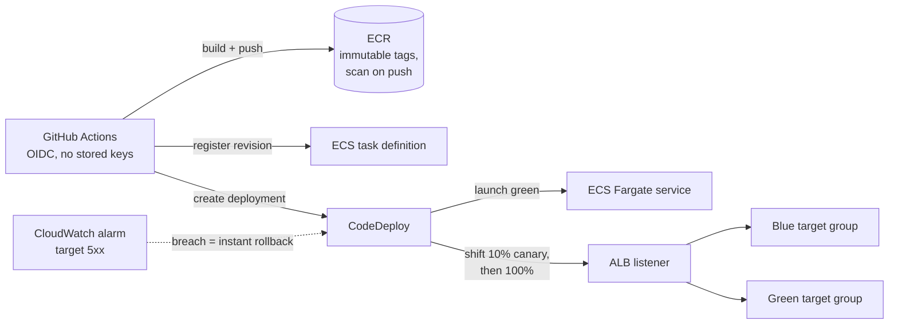

# Zero-Downtime Delivery Pipeline

A reference implementation of progressive delivery on AWS: blue/green ECS Fargate deployments through CodeDeploy with canary traffic shifting, alarm-triggered automatic rollback, and keyless OIDC CI/CD from GitHub Actions. Deployments shouldn't be scary; this repo shows the receipts.

**Stack:** ECS Fargate · CodeDeploy (canary 10%/5min) · ALB blue/green target groups · CloudWatch alarms · GitHub Actions OIDC · OpenTofu

## How a deploy flows



1. Push to `main` → workflow assumes an IAM role via OIDC (no AWS keys in GitHub).
2. Image builds, pushes to ECR (immutable tag = commit SHA, scanned on push).
3. New task definition revision registers; CodeDeploy starts a blue/green deployment.
4. Green tasks launch beside blue; **10% of traffic shifts for 5 minutes** (canary).
5. If the target-5xx CloudWatch alarm breaches, CodeDeploy **rolls back automatically**.
6. Clean canary → 100% shift, blue terminates after a 5-minute safety window.

## Demo the rollback

The point of the project. Trigger the workflow manually with `chaos=1`:
the new version's `/healthz` starts returning 503, the ALB alarm breaches
during the canary window, and CodeDeploy reverts traffic to blue with zero
failed user requests on the stable path. Watch it in the CodeDeploy console.

## Deploy

```bash
cd infra
tofu init && tofu apply
```

Then one-time wiring:

1. Set the `AWS_DEPLOY_ROLE_ARN` repo variable to the `github_deploy_role_arn` output.
2. Seed the first image (the service needs a `bootstrap` tag to start):

```bash
aws ecr get-login-password | docker login --username AWS --password-stdin <ecr_repository>
docker build -t <ecr_repository>:bootstrap app/ && docker push <ecr_repository>:bootstrap
```

3. Push to `main` and watch the canary in the CodeDeploy console. `alb_url` output serves the app; `{"version": ...}` tells you which deployment you're hitting.

## Design choices

- **Canary over linear**: a 10%/5min canary catches bad releases with minimal blast radius while staying demo-friendly.
- **Alarm-gated**: rollback is automated on a real signal (target 5xx), not a human watching dashboards.
- **OIDC only**: the deploy role trusts exactly one repo and one branch; rotating leaked PATs is not a thing here.
- **Immutable tags + scan-on-push**: the image you tested is bit-for-bit the image you shipped.
- **Default VPC**: keeps the demo cheap and reviewable; swap in a private-subnet VPC module for production.

## License

MIT — built by [Christopher Corbin](https://christophercorbin.cloud)
