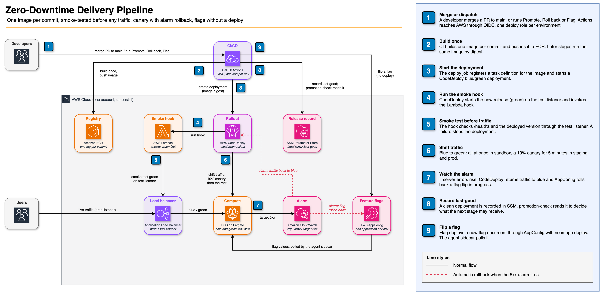
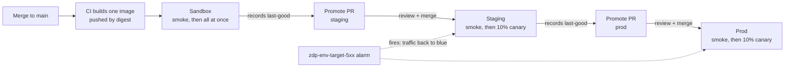

# Zero-Downtime Delivery Pipeline

A working template for trunk-based delivery on AWS. Copy it to get, from day one:

- one build per commit on `main`, deployed by image digest to **sandbox → staging → prod**;
- a blue/green CodeDeploy rollout in every environment, smoke-tested on a test listener before any user traffic, with a **10% / 5-minute canary** in staging and prod that rolls back on its own when server errors rise;
- promotion and rollback by pull request, where `promotion-check` refuses anything that has not already run cleanly in the stage before;
- feature flags through AppConfig, flipped per environment without a deploy and rolled back on the same alarm;
- keyless GitHub Actions (OIDC), one deploy role per environment.

The app is a stand-in HTTP service, so it is obvious what a project replaces.

**Stack:** ECS Fargate · CodeDeploy blue/green · ALB · CloudWatch alarms · AppConfig · GitHub Actions OIDC · OpenTofu · Node 26 (TypeScript, run directly)

## Architecture



The numbered steps are explained in the legend on the right; click the image to open it full size.

The cluster, load balancer, registry, CodeDeploy application and smoke hook are shared. Each of sandbox, staging and prod has its own listeners, target groups, service, alarm, deployment group and AppConfig application. To edit the diagram, open the PNG in [draw.io](https://app.diagrams.net); the source is embedded in it.

## How a release flows



Every deployment, in every environment:

1. CodeDeploy starts the new release (green) beside the running one (blue) and attaches it to the environment's **test listener** only.
2. The `AfterAllowTestTraffic` hook (Lambda `CodeDeployHook_zdp-smoke`) checks that `/healthz` returns 200 and `/` reports the commit being deployed. A failure stops the deployment before any user traffic.
3. Traffic shifts: all at once in sandbox, 10% for 5 minutes then the rest in staging and prod. The environment's alarm (`zdp-<env>-target-5xx`: five or more 5xx in a minute, summed over blue and green) returns all traffic to blue if it fires.
4. Only a clean deployment is recorded as the environment's **last-good** (SSM `/zdp/<env>/last-good`). A failure anywhere, sandbox included, leaves the previous release serving and records nothing.

Day-to-day use (releasing, rolling back, flags, timings) is in [CONTRIBUTING.md](CONTRIBUTING.md).

### Endpoints

| | sandbox | staging | prod |
|---|---|---|---|
| Users (prod listener) | `http://<alb>:8081` | `http://<alb>:8082` | `http://<alb>:8083` |
| Green during a deploy (test listener) | `:9081` | `:9082` | `:9083` |

`<alb>` is the `alb_dns_name` tofu output (`app_urls` lists the three user URLs). The app serves `/healthz`, `/` (`{ service, version, uptimeSeconds }`) and `/drill/alarm`, which returns 500 while the `alarmDrill` flag is on and 404 while it is off.

### Workflows (Actions tab)

| Workflow | What it does |
|---|---|
| **CI** | Checks every PR and push; on `main`, builds the image and deploys sandbox. `ci-ok` and `promotion-check` are the required checks. |
| **Deploy (reusable)** | Deploys one release to one environment, inside that GitHub Environment. |
| **Promote** | Opens a PR setting `deploy/<env>.json` to the previous stage's last-good. |
| **Apply promotion** | Deploys what a merged promotion or rollback PR names. |
| **Roll back** | Sandbox: redeploys an earlier release. Staging and prod: opens a PR. |
| **Flag** | Turns one flag on or off in one environment. |
| **Drift check** | Hourly: deploy file, last-good and the running image must agree. |
| **Stale flags** | Weekly: lists flags older than 60 days. |

While a deployment is in progress, until it reaches Succeeded and records last-good, **Drift check** can report the new digest as "not last-good". Re-run it after the deploy finishes.

## Setup

One AWS account, region `us-east-1`. The commands below use `AWS_PROFILE=personal-sandbox`; use your own profile, and see [Copying this template](#copying-this-template) for the values to change first.

1. **Tools.** `nvm use 26` (reads `.nvmrc`), then `npm ci && npm test`. You also need OpenTofu ≥ 1.10, the AWS CLI, `gh` and `jq`.
2. **GitHub repo.** Create it public (CODEOWNERS reviews and environment protection on a free plan need that): `gh repo create <owner>/<repo> --public`. Don't push yet. The local branch must be called `main` (`git branch -M main`).
3. **State bucket (once).** The bucket holds bootstrap's own state too (`infra/bootstrap/backend.tf`), so the first apply runs with local state and then moves it into the bucket:
   ```sh
   cd infra/bootstrap
   mv backend.tf backend.tf.off
   AWS_PROFILE=personal-sandbox tofu init && AWS_PROFILE=personal-sandbox tofu apply
   mv backend.tf.off backend.tf
   AWS_PROFILE=personal-sandbox tofu init -migrate-state   # answer yes
   rm -f terraform.tfstate terraform.tfstate.backup
   ```
   The bucket has versioning and `prevent_destroy`.
4. **Infrastructure.** `cd infra && AWS_PROFILE=personal-sandbox tofu init && AWS_PROFILE=personal-sandbox tofu apply`. It is applied locally, by a person: there is no CI apply workflow or role. *(This repo is exempt from the maintainer's usual rule that personal-account infra goes through a central OpenTofu repo, because a template must be self-contained.)*
5. **GitHub App.** Release PRs must be opened by an App: a PR opened with `GITHUB_TOKEN` never triggers CI, so `promotion-check` would never run. Create an App with repository permissions **Contents: read and write** and **Pull requests: read and write**, generate a private key, and install it on the repo. Note its App ID.
6. **Configure GitHub.** `scripts/configure-github.sh <app-id>`. It reads the tofu outputs, creates the `sandbox`, `staging`, `prod` and `release-automation` environments (deployable from `main` only), sets `DEPLOYER_ROLE_ARN` per environment plus `PR_READ_ROLE_ARN`, `MAIN_READ_ROLE_ARN` and `AUTOMATION_APP_ID`, and stops Actions from approving PRs.
7. **App key.** `gh secret set AUTOMATION_APP_KEY -R <owner>/<repo> --env release-automation < <key>.pem`.
8. **First push.** `git push -u origin main`. CI builds the first image and deploys sandbox: the deploy scales the empty service to one task, and the first release is recorded as last-good.
9. **Protect `main`.** Re-run `scripts/configure-github.sh <app-id>`. Now that `main` exists, it adds branch protection: required checks `ci-ok` and `promotion-check` (strict), code-owner review, linear history, and admin bypass left on (`enforce_admins: false`).

Then run **Promote** for staging, review and merge its PR, and do the same for prod.

## Drills

The pipeline's failure paths are proved with throwaway commits and a flag, not drill code: nothing here ships in a release. Make each change on a branch and merge it through a PR as usual, and revert it the same way.

### 1. Smoke failure: stopped before any traffic

1. Make `/` in `src/app.ts` report the wrong version (`version: 'drill'` instead of `version: opts.version`), and change its test in `test/app.test.ts` to expect `'drill'`, so CI stays green (the sandbox deploy only runs when the unit tests pass). Leave `/healthz` alone: it is also the target group's health check, so green must stay healthy for the hook to run at all.
2. Merge. CI builds the image and **Deploy (reusable)** runs for sandbox.
3. Expect the smoke hook to fail on the test listener (its log says `/ reports version "drill", expected "<sha>"`) and CodeDeploy to fail the deployment. The run fails with `::error::sandbox deployment <id> Failed: <code> <message>; CodeDeploy returned traffic to the previous release; nothing recorded`, where `<code>` and `<message>` are the deployment's `errorInformation`.
4. Check that users never saw it: `curl http://<alb>:8081/` still reports the previous `version`, and last-good is unchanged. In the first real run the run failed about 4 minutes after the merge.
5. Revert the commit through a PR; it deploys and records normally.

A release whose `/healthz` fails is a different failure: green never becomes healthy, so the hook never runs and CodeDeploy waits. `deploy.sh` stops such a deployment with auto-rollback at its 40-minute timeout and fails with `did not finish in 40 minutes; stopped it with auto-rollback; nothing recorded`.

### 2. Canary alarm: rolled back under real traffic (staging)

1. Make `/` in `src/app.ts` return 500 whenever the request has a query string (`req.url.includes('?')`). The smoke hook and the unit tests call plain `/`, so both pass.
2. Merge. Sandbox deploys cleanly and records the release as last-good (sandbox gets no traffic during its deployment).
3. Run **Promote** for staging, then review and merge its PR. **Apply promotion** starts the staging deployment.
4. When the CodeDeploy console shows traffic shifting (10% on green), drive traffic: `scripts/drill-traffic.sh "http://<alb>:8082/?drill" 600`. About 5 requests a second means about 30 reach green each minute, all 500.
5. Expect `zdp-staging-target-5xx` to fire within a few minutes, CodeDeploy to return all traffic to blue (the 5xx count in the drill output stops rising), and the Apply promotion run to fail with nothing recorded. Staging's last-good is unchanged. In the first real run the alarm fired 2m37s after traffic started, CodeDeploy stopped the deployment (`ALARM_ACTIVE`) 26 s later, and 90 of about 1,000 requests failed before the count froze: the 10% on green.
6. Revert the commit through a PR. Until the revert's sandbox deploy records a new last-good, **do not promote sandbox to prod**: its last-good is the drill release.
7. Restore staging's intent. The merged promotion PR left `deploy/staging.json` naming the drill release while the previous one is still running, so **Drift check** reports `staging: deploy/staging.json asks for <drill> but <previous> is running` every hour until this is fixed. Run **Roll back** for `staging` with the previous release's full SHA (staging's last-good: `aws ssm get-parameter --name /zdp/staging/last-good --query Parameter.Value --output text | jq -r .sha`), then review and merge the PR it opens. Alternatively, once the revert is sandbox's last-good, run **Promote** for staging again.

Drill 1 needs no such step: sandbox has no deploy file, and after the rollback it is still running its last-good.

### 3. Flag alarm: AppConfig rolls the flag back (sandbox)

1. **Actions → Flag**: `sandbox`, `alarmDrill`, `on`.
2. Wait about a minute for the flag to reach the app (`curl http://<alb>:8081/drill/alarm` turns from 404 to 500), then send a burst: `for i in $(seq 20); do curl -s -o /dev/null -w '%{http_code}\n' http://<alb>:8081/drill/alarm; done`.
3. Expect `zdp-sandbox-target-5xx` to fire during the five-minute watch, AppConfig to put the previous value back, and the Flag run to fail with "rolled back". `/drill/alarm` returns 404 again. Don't poll `/drill/alarm` to see when that happens: until the flag is back off, each poll is a 500, and polling faster than five a minute keeps the alarm firing. Watch the Flag run instead.
4. Wait for the alarm to return to `OK` before flipping anything else in sandbox, or merging to `main`: a sandbox deployment started while the alarm fires is stopped and rolled back.

## Design choices

- **Blue/green with a smoke gate in every environment.** CodeDeploy rolls back to blue by itself, so a failed deploy anywhere leaves the previous release serving. Sandbox gets the same treatment as prod: there is nothing to inspect in a failed release that the logs do not show.
- **Canary in staging and prod.** A scripted smoke test catches what is broken for everyone; the 10% / 5-minute canary catches errors that only real traffic triggers, with a tenth of the blast radius. It only helps when there is traffic: in an environment nobody uses, the canary passes by default.
- **One alarm per environment** guards both deployments and flag flips. It sums blue and green, so it sees errors from whichever is serving.
- **Digests, not tags.** A release is `{ sha, digests }`. Every environment runs the image sandbox built, and nothing is resolved by tag at deploy time. Release images never expire, so a rollback can always pull.
- **last-good is the truth.** Only a clean deployment writes it, only last-good can be promoted, and `promotion-check` re-checks every promotion and rollback PR against that history.
- **Base task definitions pinned in SSM.** Deploys copy the revision tofu registered, never "latest in family", so a sandbox deploy role cannot rewrite prod's task definition.
- **Per-environment identities.** Each deploy role is trusted only for its own GitHub Environment and can deploy, write last-good and flip flags only there. Only sandbox's can push images.
- **Public test ports (a trade-off).** The smoke Lambda runs outside the VPC (a Lambda in the default VPC's public subnets has no route to the CodeDeploy API without a NAT or VPC endpoint), so it reaches green through the ALB. Ports 9081–9083 are therefore open to the internet: an unreleased build is reachable there for the few minutes of a deployment. For anything sensitive, run the hook in private subnets with a NAT or VPC endpoints and close those ports.
- **Default VPC, public subnets, plain HTTP.** Cheap and easy to review. A real service should use private subnets and TLS on the listeners.
- **One maintainer.** CODEOWNERS names a single owner for every gated path. Promotion and rollback PRs are opened by the App, so they get a genuine review; the maintainer's own PRs to gated paths merge through the admin bypass, which GitHub logs. `.github/CODEOWNERS` says how to swap in real reviewer teams.
- **State in the same account,** in a bucket the template creates itself (`infra/bootstrap`), so a copy carries everything it needs.

## Copying this template

Replace:

- **The app:** `src/app.ts`, `src/main.ts` and `Dockerfile`. The pipeline needs only `GET /healthz` → 200, `GET /` → JSON whose `version` is the `VERSION` environment variable, and the server listening on `PORT` (8080).
  The base task definition's `command` (`infra/env/main.tf`) is a placeholder only; `deploy.sh` strips it, so the image's own `CMD` is what runs.
- **The smoke checks** in `infra/smoke-hook/smoke.mjs`, if your app needs more than that.
- **Flags:** `alarmDrill` in `src/core/flags/registry.ts` is the drill flag; keep it or replace it with your own.
- **Owners:** `.github/CODEOWNERS`.
- **Repo and account:**
  - `var.github_repo` in `infra/main.tf` (or `-var github_repo=…`), and `GITHUB_REPO` for `configure-github.sh`;
  - the account ID in `infra/bootstrap/main.tf`, `infra/bootstrap/backend.tf` and `infra/versions.tf` (the state bucket) and in `infra/main.tf` (the GitHub OIDC provider, which must already exist in the account).
- **The `zdp` prefix,** if more than one copy shares an account: `local.name` in `infra/main.tf`, and the `/zdp/` and `zdp/app` paths in `.github/scripts/` and `scripts/delivery/cli.ts`.
- **Sizes and timings:** task CPU and memory in `infra/env/main.tf`, and the deployment configs and blue termination waits in `local.envs` (`infra/main.tf`).

If your project adds a database, every schema change must be expand-then-contract: a rollback reverts the app, never the data.

## License

MIT — built by [Christopher Corbin](https://christophercorbin.cloud)
